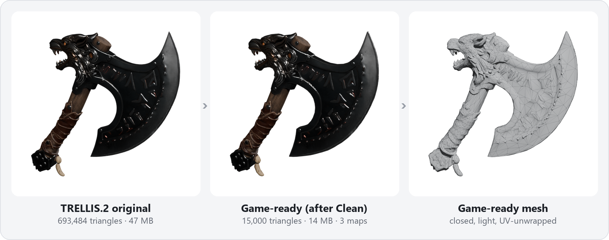
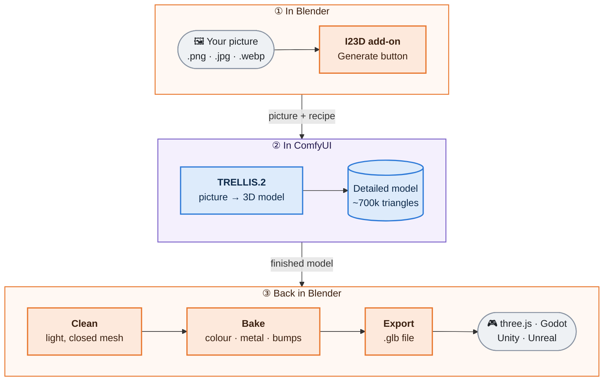
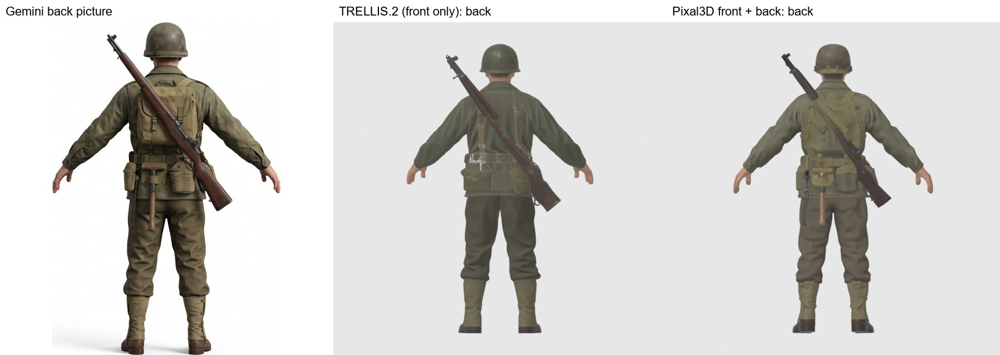
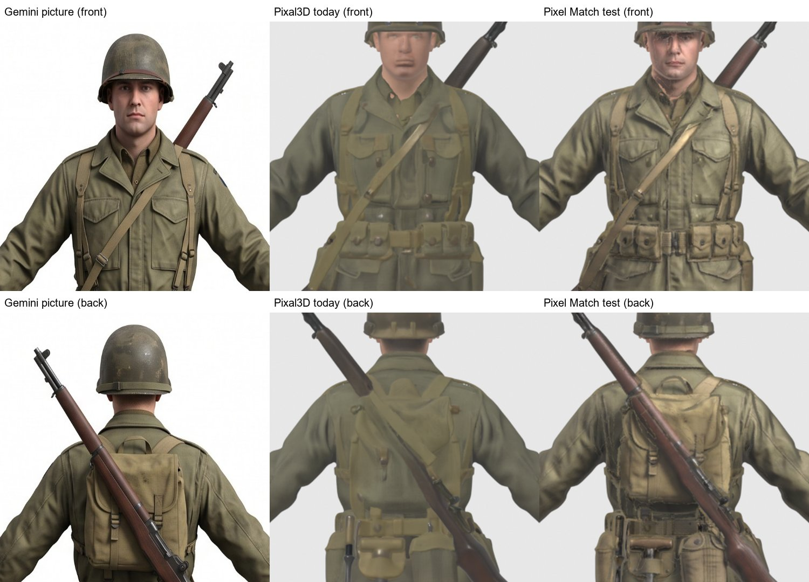
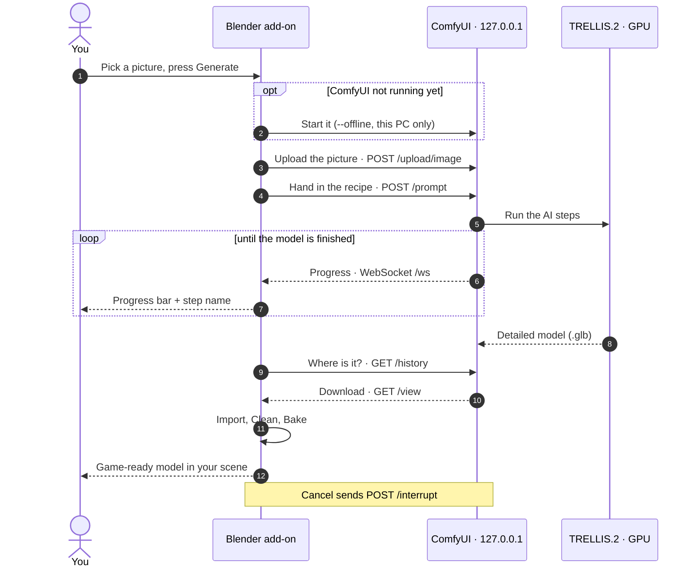
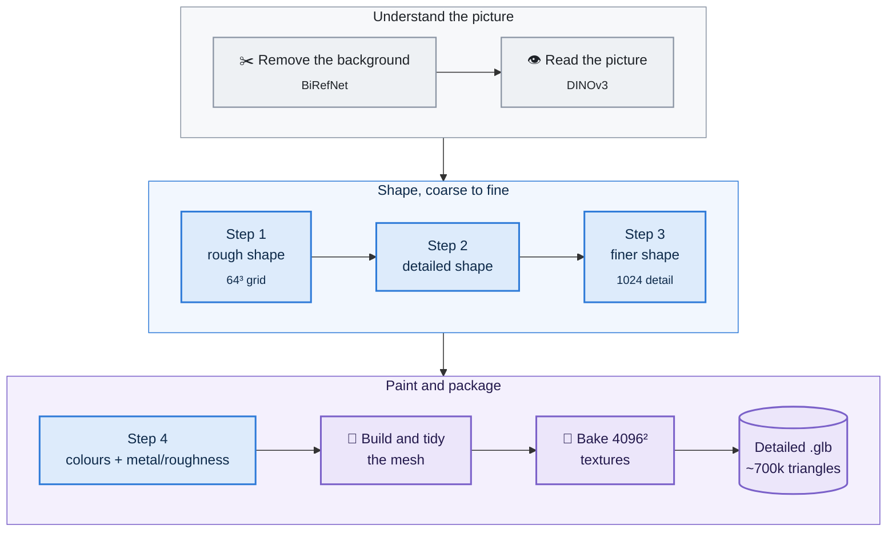
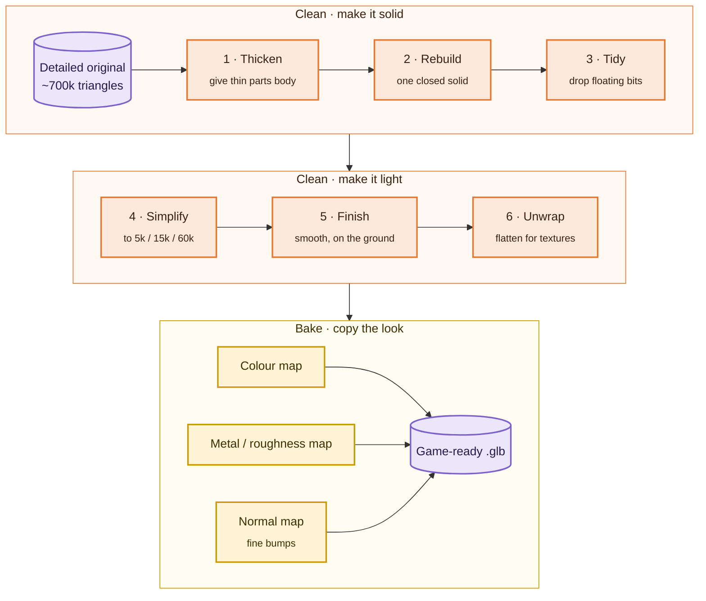
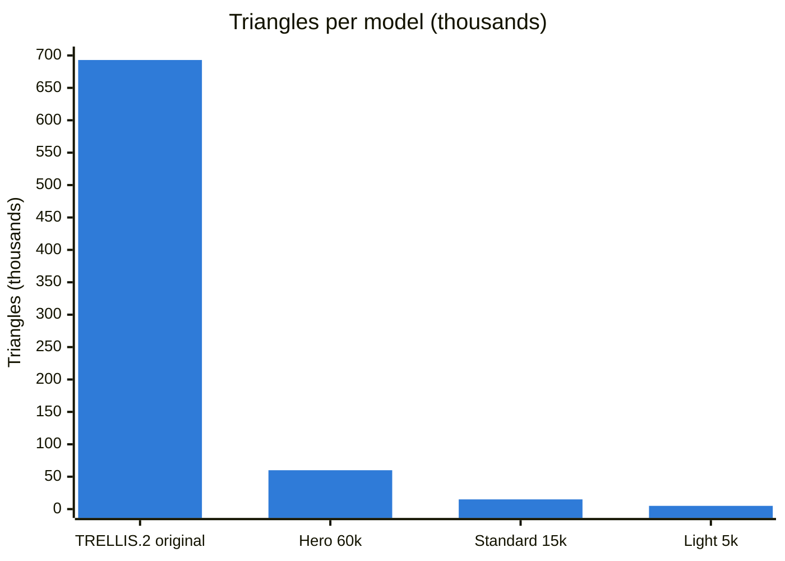
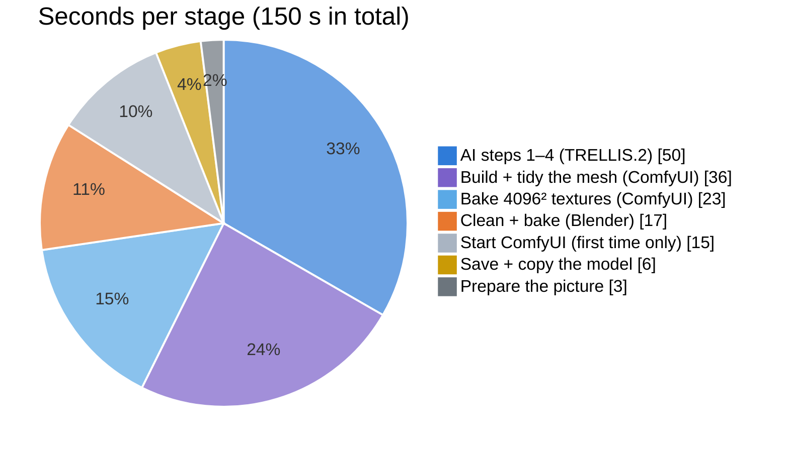

# I23D_win: Image to Game Asset (Blender + TRELLIS.2 on Windows)

Turn **one picture** into a **game-ready 3D model** (`.glb`) from a single Blender panel, running
everything **locally** on a Windows PC with an NVIDIA graphics card and Microsoft's open-source
**TRELLIS.2** AI. Have a **front and a back picture**? Then the add-on uses **Pixal3D** instead, so
the back of the model follows your picture rather than a guess. Windows port of
[I23D_mac](https://github.com/salpbes/I23D_mac).



<sub>Left: what the AI makes. Middle: what you put in your game. It looks the same at a twentieth
of the weight. Right: the light, closed mesh underneath. Made from ComfyUI's example axe picture
in about 2½ minutes.</sub>

| | |
|---|---|
| **Tested on** | Windows 11, NVIDIA RTX 5060 Ti 16 GB, Ryzen 9 3900X, 64 GB memory, Blender 5.2.2 LTS |
| **How TRELLIS.2 runs** | ComfyUI v0.39.0 portable, started by the add-on with `--offline`, listening on 127.0.0.1 only |
| **Time per model** | under 3 minutes at Standard detail (1024), including starting ComfyUI; peak graphics memory 11.5 GB |
| **Needs** | Windows 10/11, NVIDIA card with 16 GB (12 GB may work), ~25 GB free disk, Blender 4.2 or newer; no account of any kind |

**Get started:** download `image_to_game_asset-2.5.0.zip` from the
[latest release](https://github.com/salpbes/I23D_win/releases/latest), then follow
[docs/GETTING_STARTED.md](docs/GETTING_STARTED.md): every click, with screenshots, from the download
to your first `.glb`. No Blender experience needed. The short version is in [Quick start](#quick-start-windows).

## How it works, in one picture

You only ever touch Blender. Behind the **Generate** button, three programs work as a team, all
on your own PC:



1. **TRELLIS.2** looks at your picture and builds a detailed, painted 3D model.
2. **ComfyUI** is the program that runs TRELLIS.2 on your graphics card.
3. **Blender** asks for the model, then makes it light and tidy enough for a game and saves it
   as a `.glb` file that game engines and websites can open.

## The three tools, and why each one

Think of a furniture workshop. **TRELLIS.2** is the sculptor who carves and paints a piece from a
single photo. **ComfyUI** is the studio: it gives the sculptor tools, power and a schedule, and
tells you how the work is going. **Blender** is the finishing and shipping department: it sands
the piece down to a sensible weight, seals the gaps and packs it in a box every shop can open.

| | Its job here | Why this one | What we ruled out |
|---|---|---|---|
| **TRELLIS.2**<br/><sub>Microsoft, open source (MIT)</sub> | Makes the 3D model from one picture: shape, colours, and which parts are metal or rough | One of the best open image-to-3D models; free, runs offline, no account. It paints real game textures (colour, metal, roughness), not just a grey shape | Paid online 3D generators: your pictures leave the PC and every model costs money |
| **ComfyUI**<br/><sub>Comfy Org, open source (GPL-3.0)</sub> | Runs TRELLIS.2 on the graphics card and reports progress | Has TRELLIS.2 built in. Its portable version is one folder with everything included and it works on new RTX 50 cards. Its compact (int8) model fits in 16 GB. It answers on a local web address, so Blender can drive it | TRELLIS.2's own installer: it needs older software that RTX 50 cards can't use, plus C++/CUDA compilers. Running it through Linux (WSL2) worked only on bigger cards and crashed |
| **Pixal3D**<br/><sub>Tencent ARC Lab, open source (MIT)</sub> | Optional: makes the model from a front **and** a back picture | Built on TRELLIS.2 and already in ComfyUI. It projects every pixel of both pictures into the 3D model, so the back isn't guessed. One extra file (5.6 GB) | Asking TRELLIS.2 to guess the back: it often copies the front |
| **Blender**<br/><sub>Blender Foundation, open source (GPL)</sub> | Your workspace: the button panel, then cleaning, baking and export | Free, and has every tool needed: remeshing, simplifying, UV unwrapping, ray-traced baking and glTF export. Many artists already use it | A separate app: you would have to import the result into Blender anyway |
| **glTF / .glb**<br/><sub>Khronos open standard</sub> | The file you take away | The "JPEG of 3D": one file holding mesh and textures, opened by three.js, Godot, Unity, Unreal and Blender | `.fbx` / `.obj`: closed format, or textures in separate files |

## Front + back pictures (new in 2.4.0)

TRELLIS.2 sees only the front, so it has to guess the back, and it often guesses wrong. Give the
add-on a back picture too and it switches to **Pixal3D**, a model built on TRELLIS.2 that uses
both pictures. The easiest way to get the pair is to ask an image AI such as Gemini for one picture
with both views side by side; the add-on splits it by itself.




<sub>Left: the back in the Gemini picture. Middle: TRELLIS.2 from the front picture only: no
backpack, no shovel. Right: Pixal3D from front + back: backpack, shovel and rifle where the
picture shows them. Same time per model (about 2 minutes), up to 14 GB graphics memory.</sub>

How to use it: choose **Front + back** at the top of the panel, pick the picture (or the front and
the back as two pictures), and press Generate. For long objects (vehicles, animals) add a **side**
picture: from the front and back alone the AI can't see the length, and a tank comes out stubby.
With a side view it gets the real shape. The first time, the panel offers the extra download
(about 6 GB). Tips for the pictures, and a prompt that works, are in
[GETTING_STARTED.md](docs/GETTING_STARTED.md#front--back-pictures-optional).

### The pictures painted on (new in 2.5.0)

The AI paints its models a little soft: faces, badges and buckles come out blurred. Pixal3D knows
exactly where its two cameras were, so the add-on can trace every point of the model back to the
pixel of the picture that shows it, and copy the picture's **real colours** onto every part the
picture shows clearly. Sides and hidden parts keep the AI's colours, nudged towards the
pictures' colours so there is no seam. It adds about 15 seconds.



<sub>Left: the Gemini picture. Middle: Pixal3D's own colours. Right: the pictures painted on: the
face, pockets, pouches and backpack straps look like the picture.</sub>

It is on by default (*Paint the pictures onto the model*, under Front + back). The light and
shadow in the picture come along too (here, the helmet's shadow on the forehead); untick it and
press the colour button 🎨 for the AI's own colours. The idea comes from
[AssetFurnace's Pixel Match](https://github.com/Bingeljell/image-to-3dlab/blob/main/docs/pixel-match.md).

## How the pieces talk to each other

ComfyUI runs as a small **web server that only your own PC can reach** (`127.0.0.1` means "this
computer"). It works like a kitchen with an order window. Blender hands in an order (the picture
plus a recipe), listens for "order status" updates, then collects the finished dish. The recipe
is a ComfyUI workflow saved in [`addon/image_to_game_asset/workflows/`](addon/image_to_game_asset/workflows/).
It lists every TRELLIS.2 step and its settings.



The add-on starts ComfyUI itself the first time you press Generate (about 30 s). After that it
stays loaded, so the next pictures start straight away. The code for this conversation is in
[`trellis_runner.py`](addon/image_to_game_asset/trellis_runner.py). It has no Blender code, so it
is tested on its own against a fake ComfyUI.

## What happens inside TRELLIS.2

TRELLIS.2 builds the model **from coarse to fine**, much like a sculptor blocks out a shape before
carving details. These are the steps you see on the progress bar:



The result is beautiful but **too heavy for a game**: about 700,000 triangles and a 47 MB file,
built from thin surfaces with small gaps. A game wants a few thousand triangles and a closed solid.

## What Blender does to make it game-ready

**Clean** rebuilds the shape as a light, closed solid. **Bake** then copies the look of the
detailed original onto it, pixel by pixel, using ray tracing.



- The **colour map** carries TRELLIS.2's paint. *Match photo colours* can pull it towards your
  picture.
- The **metal/roughness map** keeps metal parts shiny and wood or cloth matte.
- The **normal map** fakes the small carvings and bumps that 15,000 triangles can't hold, so the
  light model still catches the light like the detailed one.

You choose the size. The shape is rebuilt each time, so you can make several sizes from the same
original:



## Where the time goes

Measured on the RTX 5060 Ti 16 GB for the axe above. It includes starting ComfyUI from cold, so
it is 150 s in total. Later pictures skip the first slice.



## Quick start (Windows)

New to Blender? [docs/GETTING_STARTED.md](docs/GETTING_STARTED.md) walks through every click,
with screenshots, from the download to your first `.glb`.

1. **Download** `image_to_game_asset-2.5.0.zip` from the
   [latest release](https://github.com/salpbes/I23D_win/releases/latest). Don't unzip it.
2. **Install it:** Blender › Edit › Preferences › Get Extensions › ⌄ (top right) ›
   **Install from Disk…** › pick the zip.
3. **Install ComfyUI + TRELLIS.2:** 3D View › press **N** › **Image→3D** tab. Its **One-time
   setup** box has the **Install ComfyUI + TRELLIS.2** button; press it and say yes. It downloads
   about 11 GB into `%USERPROFILE%\I23D` (first time only, no account needed) in its own window,
   while the panel shows a progress bar and Blender stays usable. At the end Blender checks the
   setup by itself and says **Setup finished**.
4. Pick a picture: the panel shows it with its background removed and says if it looks good.
   (Have a front and a back picture? Choose **Front + back** first; see
   [above](#front--back-pictures-new-in-240).) Press **Generate 3D Model**. The model appears in
   colour, centred in the view.
   Then **Export .glb**: the file goes to `%USERPROFILE%\I23D\output\game-ready`.

That zip is all you need: the installer ships inside it.

<details>
<summary>From the source code instead</summary>

```bash
git clone https://github.com/salpbes/I23D_win.git
```
Install ComfyUI + TRELLIS.2 from PowerShell in the repo folder (`-Check` only checks your PC and
installs nothing):
```bash
powershell -ExecutionPolicy Bypass -File scripts\install_comfyui.ps1 -Check
```
```bash
powershell -ExecutionPolicy Bypass -File scripts\install_comfyui.ps1
```
Build the add-on zip into `dist\` and install it as in step 2:
```bash
powershell -ExecutionPolicy Bypass -File scripts\build_addon.ps1
```
</details>

Every step and setting explained: [docs/WORKFLOW.md](docs/WORKFLOW.md).

## Is anything sent online?
No. The picture, the AI work and the model all stay on your PC. The add-on talks to ComfyUI at
`http://127.0.0.1:8188`, which other computers can't reach, and starts it with `--offline`
(no paid online "partner" nodes, no web requests from its page). Internet is used only by the
installer (the **Install ComfyUI + TRELLIS.2** and **Download for Front + Back** buttons), to
download ComfyUI and the model files once.
The add-on only reads the installer's progress from a file on your PC.

## What's in this repo

```
addon/image_to_game_asset/   the Blender add-on (one job per file, see __init__.py)
  trellis_runner.py            start ComfyUI, send the TRELLIS.2 job, read progress (no Blender code)
  workflows/                   the TRELLIS.2 ComfyUI workflow + the model files it needs (and Pixal3D's, for front + back)
  cleanup.py                   messy AI mesh → light, closed game mesh
  baking.py                    bake TRELLIS.2's colours, metal/roughness + normal maps onto the game mesh (+ photo colour match)
  photo_paint.py               front + back: paint the pictures the AI saw onto its model (Pixel Match)
  materials.py / exporter.py   material presets / .glb export
  pipeline.py                  glue used by the buttons
  install/install_comfyui.ps1  the ComfyUI + TRELLIS.2 installer (ships in the zip)
  installer.py                 starts it in its own window and follows its progress (the Install button)
  properties.py / preferences.py / operators.py / ui.py   settings, buttons, panel
scripts/
  install_comfyui.ps1          runs the add-on's installer from the repo: ComfyUI portable + TRELLIS.2 models
  build_addon.ps1              packs the add-on into an installable zip
  make_addon_workflow.py       rebuilds workflows/ from ComfyUI's TRELLIS.2 template
  comfy_workflow_to_api.py     turns a ComfyUI editor workflow into the API format
tools/photo_texture/         experimental photo-fitting helpers (see its README)
tests/                       automatic tests with a fake ComfyUI, plus a real end-to-end test
docs/                        getting started (with screenshots), workflow, Windows findings, detailed characters, troubleshooting
```

## Documentation
- [GETTING_STARTED.md](docs/GETTING_STARTED.md): from download to your first `.glb`, with screenshots
- [WORKFLOW.md](docs/WORKFLOW.md): every step and setting, in plain words
- [WINDOWS.md](docs/WINDOWS.md): how the Windows route was chosen and tested
- [DETAILED_CHARACTERS.md](docs/DETAILED_CHARACTERS.md): better faces and feet with zoom-in crops
- [TROUBLESHOOTING.md](docs/TROUBLESHOOTING.md): problems and their fixes

## Tests
```bash
powershell -ExecutionPolicy Bypass -File tests\run_tests.ps1
```
No graphics card needed: a fake ComfyUI stands in. They check progress, error messages, Cancel,
starting/stopping ComfyUI, that the add-on zip carries its installer (and installs into Blender),
cleaning to budget, watertight results, colour baking accuracy (from colour layers and from
textures), metal/roughness and normal map baking, photo colour matching and `.glb` export with
textures.

With the real ComfyUI and TRELLIS.2 (about 4 minutes, uses the graphics card):
```bash
"C:\Program Files\Blender Foundation\Blender 5.2\blender.exe" -b --factory-startup -P tests\e2e_real_bpy.py -- picture.png out_folder
```

## Credits and licences
- **TRELLIS.2** by Microsoft (MIT): https://github.com/microsoft/TRELLIS.2
- **ComfyUI** by Comfy Org (GPL-3.0), with its native TRELLIS.2 nodes and model files:
  https://github.com/Comfy-Org/ComfyUI (downloaded by the installer, not part of this repo)
- **BiRefNet** by ZhengPeng7 (MIT): background removal
- **DINOv3** by Meta: picture understanding (its own licence; check before commercial use)
- **Pixal3D** by Tencent ARC Lab and Tsinghua University (MIT; its third-party parts keep their own
  terms, see its NOTICE): front + back pictures. https://huggingface.co/TencentARC/Pixal3D
- **AssetFurnace** by Bingeljell (Apache-2.0): the idea of painting the pictures back onto the model
  ("Pixel Match"). The add-on has its own implementation. https://github.com/Bingeljell/image-to-3dlab
- Built with help from Claude (Anthropic).

Licences in this repo:
- Scripts, tools, tests, docs: **MIT** (see `LICENSE`).
- Blender add-on (`addon/image_to_game_asset/`): **GPL-3.0-or-later** (see its own `LICENSE`).
  Blender add-ons must use a GPL-compatible licence because they use Blender's Python API.

Third-party models have their own licences and terms.

## Disclaimer

This project is free software, provided **"as is", without warranty of any kind**. Its licences
already say so: the MIT licence (`LICENSE`) and the GPL-3.0-or-later licence of the add-on
(`addon/image_to_game_asset/LICENSE`, sections 15 and 16). In plain words:

- **You are responsible for how you use it.** The authors and contributors are not liable for any
  misuse of this add-on, of the AI models it runs, or of the 3D models it makes, nor for any loss
  or damage that comes from using them.
- **Use only pictures you have the right to use.** Respect other people's copyright, trademarks,
  designs and likeness. A generated model can look very much like its picture, so the rights in
  the picture can also apply to the model.
- **Follow the law and the third-party licences.** TRELLIS.2, Pixal3D, ComfyUI, BiRefNet and DINOv3 each have
  their own licence and terms, and some limit how their output may be used. Check them before you
  sell or publish what you make.
- **Check what the AI makes.** Its output can be wrong or unexpected. Look over every model before
  you use it in a game, product or anything other people rely on.
- **Don't use it to make anything illegal, harmful or deceptive**, or anything that infringes
  someone else's rights.

This summary is not legal advice. Where it and the licence texts differ, the licence texts apply.
