# Getting started: from download to your first `.glb`

This guide takes you from nothing to a game-ready 3D model, one click at a time. You don't need to
know Blender or anything about AI 3D models. Red boxes in the pictures show what to click.

Plan for about 15 minutes of clicking, plus a one-time download of about 11 GB.

## Before you start

- **A Windows 10 or 11 PC with an NVIDIA graphics card that has 16 GB of graphics memory**
  (12 GB may work). To check: Task Manager › Performance › GPU › *Dedicated GPU memory*.
- **About 25 GB of free disk space.**
- **Blender 4.2 or newer**, free from [blender.org/download](https://www.blender.org/download/)
  (tested with 5.2).
- **Internet for the one-time download.** No account or sign-up needed. After that, everything
  runs offline on your own PC.
- **A picture of one object** (`.png`, `.jpg` or `.webp`): plain or see-through background, seen
  slightly from the side and from above.

## Part 1: Install (once)

### 1. Download the add-on

From the [latest release](https://github.com/salpbes/I23D_win/releases/latest), download
`image_to_game_asset-2.5.0.zip`. **Don't unzip it.** That one file is all you need.

### 2. Open "Install from Disk"

In Blender: **Edit › Preferences › Get Extensions**, then the small **⌄** menu at the top right ›
**Install from Disk…**. You can ignore the "Internet access" note: installing from disk works
offline.

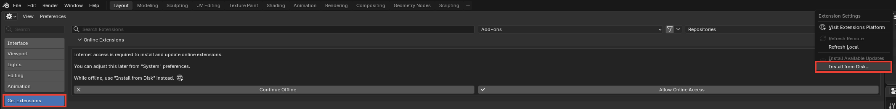

### 3. Pick the zip

Click the zip you downloaded, then **Install from Disk**. Leave *Enable on Install* ticked. Then
close the Preferences window.

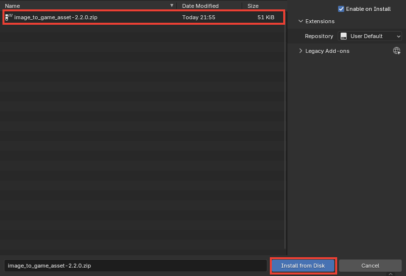

### 4. Open the panel and press "Install ComfyUI + TRELLIS.2"

Move the mouse over the big 3D view and press **N**. A side panel opens on the right; click its
**Image→3D** tab. The first time, it starts with a **One-time setup** box. Press
**Install ComfyUI + TRELLIS.2**.

(The same button is also in **Edit › Preferences › Add-ons › Image to Game Asset**.)

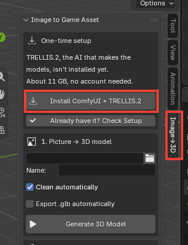

### 5. Say yes to the download

Blender asks first. It shows how much it downloads (about 11 GB) and where it goes
(`%USERPROFILE%\I23D`, a folder in your user folder). Press **Download and Install**.

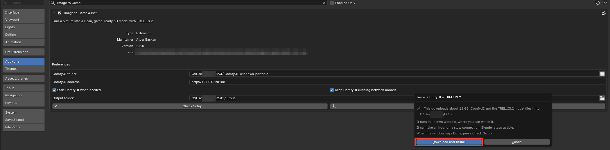

### 6. Wait while it downloads

The panel shows a progress bar and how many GB are done. It downloads ComfyUI (about 2 GB), the
program that runs the AI, and then the TRELLIS.2 model files (about 9 GB), the AI itself.
Depending on your internet this takes from a few minutes to about an hour. Blender stays usable
meanwhile.

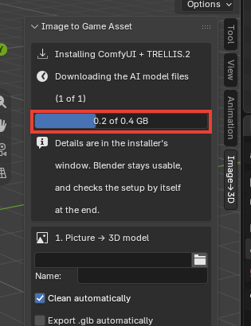

A separate window opens too and does the actual work, with the details. Leave it open until
Blender says the setup is finished. If it gets closed early, just press Install again: finished
files are skipped and a stopped download carries on where it left off.


### 7. Setup finished

When the download is done, Blender checks the setup by itself and says **Setup finished**. You
can close the installer window now. If something is missing, the panel says what, with the
Install button to fix it.

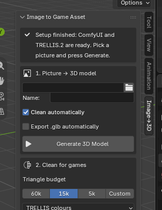

## Part 2: Your first model

### 8. Clear the starting scene

A new Blender scene starts with a grey cube in the middle, exactly where your model will appear.
Click the cube, press **X**, then **Delete**.

### 9. Pick a picture and look at its check

In the **Image→3D** panel, click the folder icon next to the empty picture box and choose your
picture. The name fills itself in.

A few seconds later (the first time about half a minute, while ComfyUI starts) the panel shows
your picture with its background removed, exactly as TRELLIS.2 will see it, and says whether it
looks good. Press **View Larger** to see it in its own window; scroll there to zoom.

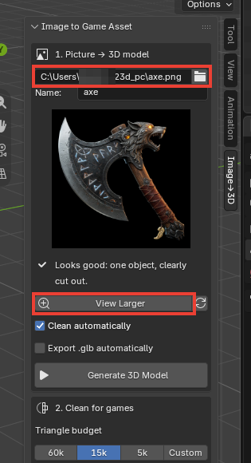

If the panel warns about something, a better picture usually gives a better model:

- **Several separate pieces:** TRELLIS.2 makes one model of everything it sees. Use a picture
  of one object.
- **Touches the edge:** part of the object is outside the picture and will be guessed. Leave a
  little space around it.
- **Small object or small picture:** crop closer to the object, or use a bigger picture.
- **The cut-out lost parts or kept background:** use a picture with a plainer background.

You can still press Generate anyway.

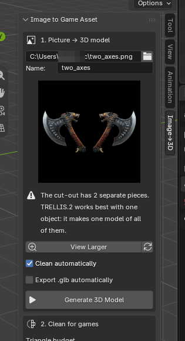

### 10. Press "Generate 3D Model"

The bar shows each step as the AI works. On an RTX 5060 Ti 16 GB a model takes about 2 to 3
minutes. The very first time, the add-on also needs about 30 seconds to start ComfyUI in the
background. Blender stays usable meanwhile, and **Cancel** stops the run.

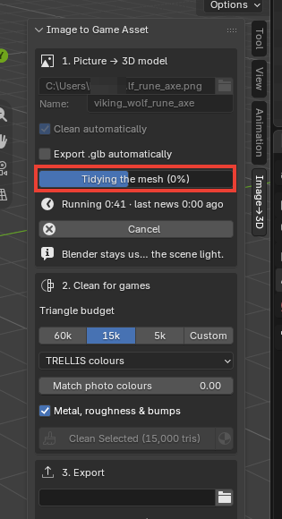

### 11. Look at your model

The model appears in colour, and the view turns to it by itself. It is already cleaned for
games: light (15,000 triangles), closed, standing on the ground, with its colours, metal and fine
bumps baked on. The panel lists what was done.

To turn the view, drag with the middle mouse button; scroll to zoom. The detailed original (about
700,000 triangles) is kept, hidden, in case you want to make another size later.

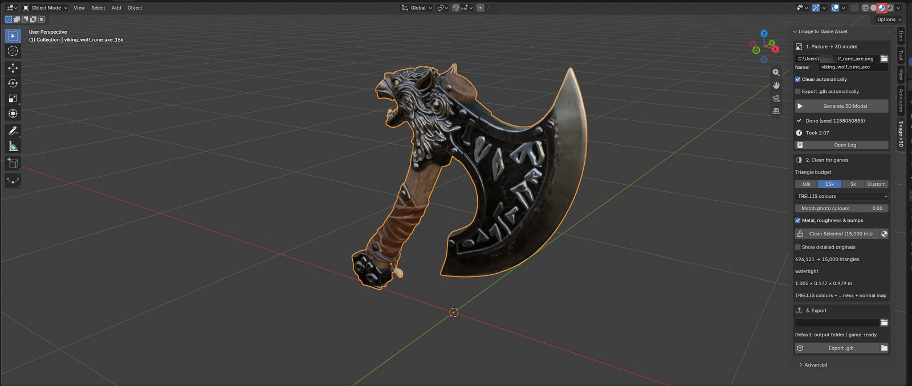

### 12. Save it as a `.glb`

Press **Export .glb**. The panel says **Saved: *name*_15k.glb**. The folder button next to it
opens the folder where it went: `%USERPROFILE%\I23D\output\game-ready`.

That `.glb` file is your game-ready model. Godot, Unity, Unreal, three.js and Blender can all
open it.

Tip: tick **Export .glb automatically** (section 1 of the panel) and every new model is saved
by itself.

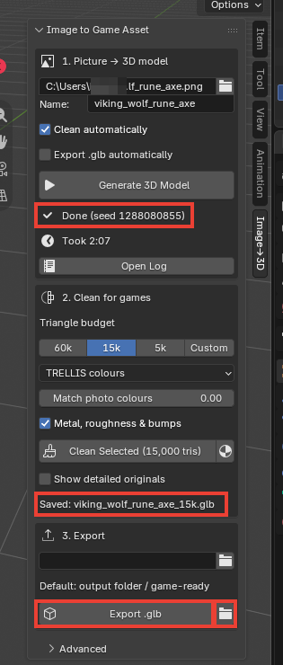

## Front + back pictures (optional)

From one picture, the AI has to guess what the back looks like. If you have a picture of the back
too, the add-on can use both, and the back of the model follows your picture.

### 13. Make a front and a back picture

The easiest way is to ask an image AI, such as Gemini, for one picture that shows both. This
prompt worked well (change the first sentence to your object):

> Create an image of an American soldier in WW2. Show both the front and back. We need a
> full-body image. Straight front view and exact back view, level camera, no rotation. Remove the
> background so only the main object is visible; no other elements are needed. Do not add any
> platforms, etc. Show the front and back side by side, high resolution, on a plain white
> background.

What matters:
- **Straight on:** an exact front and an exact back view, camera level with the object, no turn.
- **The same size** in both views.
- **Nothing else** in the picture: no titles, colour swatches or turntables.
- **Space between the two views**, so the add-on can tell where the front ends.
- **Soft, even light, no shadows on the object:** the add-on paints the picture's colours onto
  the model, light and shadow included.

Two separate pictures (one front, one back) work too, and give each view the full resolution.

<details>
<summary>A more detailed prompt (ChatGPT, Gemini or other image AIs)</summary>

Fill in the SUBJECT lines. ChatGPT follows long prompts well; if Gemini skips a rule, ask for
just that fix ("same image, but without the shadow on the face") instead of starting over.

```text
Create two separate images of the SAME object, a front view and a back view, as references for
making a 3D model.

SUBJECT
- Object: [the character, creature, vehicle, furniture or prop]
- Design, period or model: [details]
- Materials and colours: [describe]
- Accessories or parts it must have: [list, or "none"]
- Leave out: [list, or "none"]

VIEWS
- Make the FRONT image first, then use it as the reference for the BACK image.
- FRONT: exactly straight-on from the front. BACK: exactly straight-on from behind, as if the
  object were turned 180 degrees around its vertical axis. Do not mirror the front image.
- Camera level with the middle of the object, long lens, no perspective distortion, no tilt,
  no three-quarter view.
- Keep left and right: a part on the object's right side is still on its right seen from behind.

CONSISTENCY
- One identical object in both: same proportions, outline, pose, materials, colours, wear and
  accessories. Rotate the whole object; don't move its parts.
- Same canvas size, same scale, same lighting. The top and bottom of the object at the same
  height in both images.

POSE AND FRAMING
- The whole object, nothing cut off, centred on a square canvas with a small margin around it.
- Characters: neutral A-pose, arms slightly away from the body, legs straight, feet forward.
- Other objects: their normal upright position.

LOOK
- Realistic proportions and plausible construction; accurate for real models or periods.
- If a back detail is unknown, choose the most plausible, typical design.
- Soft, even, neutral light. Matte look: no shiny reflections or highlights, no cast shadows on
  the object itself (for example under a hat or helmet brim), no depth of field.

BACKGROUND
- A truly transparent background if you can make real transparency; otherwise plain, flat pure
  white (#FFFFFF). Never draw a checkerboard.
- Only the object: no floor, shadow, platform, scenery, text, labels or watermark.

OUTPUT
- Two separate square images, as large as you can make them (1024 x 1024 or more).
- Before you finish, check that both views match in scale, pose, proportions and where each
  part is.
```

</details>

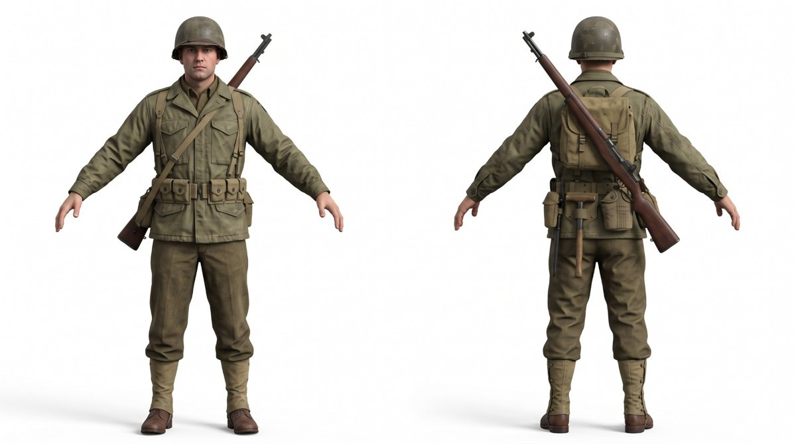

### 14. Choose "Front + back" and pick the picture

At the top of section 1, click **Front + back**. Then pick the picture in the first box. If the
front and back are separate pictures, pick the front there and the back in the second box.

The first time, the panel says **Front + back pictures need one more download** (about 6 GB).
Press **Download for Front + Back** and say yes. It downloads in its own window, like the first
install, and the panel shows the progress.

The check shows both cut-outs and says whether they match. **Front** and **Back** open them
larger.

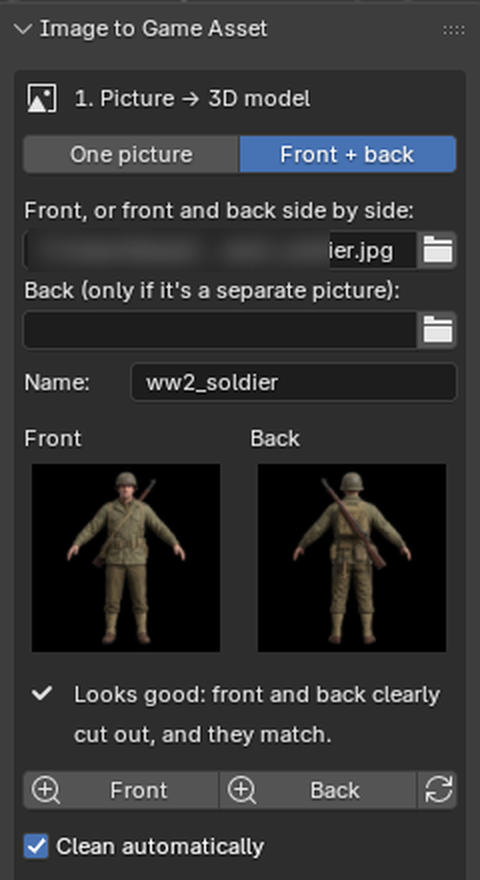

### 15. Press "Generate 3D Model"

Everything else works as before. The model takes about as long as with one picture.

The add-on also paints the pictures' real colours onto the parts of the model they show clearly,
so faces and small details look like your picture (*Paint the pictures onto the model*, on by
default). If you prefer the AI's own colours, untick it and press the colour button 🎨 next to
**Clean Selected**.

## Next

- Smaller or bigger models, other colours, every setting: [WORKFLOW.md](WORKFLOW.md)
- Something went wrong: [TROUBLESHOOTING.md](TROUBLESHOOTING.md)
- Why front + back gives a better back: [README](../README.md#front--back-pictures-new-in-240)
- Before you sell or publish what you make: read the [Disclaimer](../README.md#disclaimer)

<sub>Screenshots: Blender 5.2.2 on Windows 11 with an RTX 5060 Ti 16 GB. The picture is ComfyUI's
example axe.</sub>
