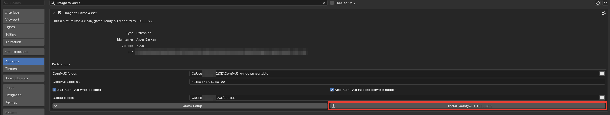
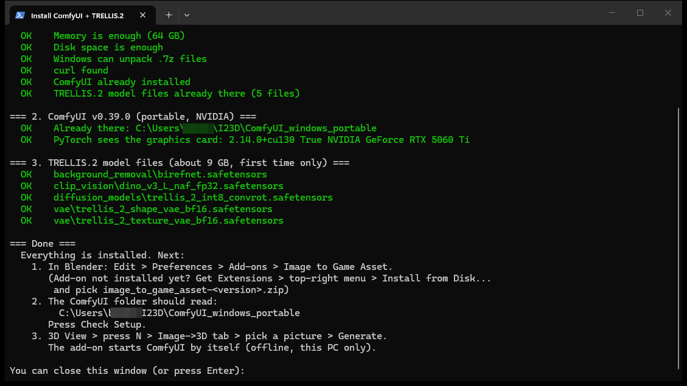
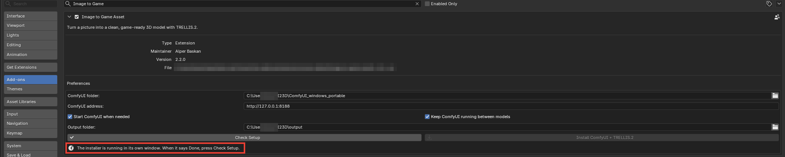
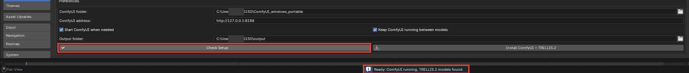

# Getting started: from download to your first `.glb`

This guide takes you from nothing to a game-ready 3D model, one click at a time. You don't need to
know Blender or anything about AI 3D models. Red boxes in the pictures show what to click.

Plan for about 15 minutes of clicking, plus a one-time download of about 11 GB.

## Before you start

- **A Windows 10 or 11 PC with an NVIDIA graphics card that has 16 GB of graphics memory**
  (12 GB may work). To check: Task Manager › Performance › GPU › *Dedicated GPU memory*.
- **About 25 GB of free disk space.**
- **Blender 4.2 or newer**, free from [blender.org/download](https://www.blender.org/download/)
  (tested with 5.2).
- **Internet for the one-time download.** No account or sign-up needed. After that, everything
  runs offline on your own PC.
- **A picture of one object** (`.png`, `.jpg` or `.webp`): plain or see-through background, seen
  slightly from the side and from above.

## Part 1: Install (once)

### 1. Download the add-on

From the [latest release](https://github.com/salpbes/I23D_win/releases/latest), download
`image_to_game_asset-2.2.0.zip`. **Don't unzip it.** That one file is all you need.

### 2. Open "Install from Disk"

In Blender: **Edit › Preferences › Get Extensions**, then the small **⌄** menu at the top right ›
**Install from Disk…**. You can ignore the "Internet access" note: installing from disk works
offline.

### 3. Pick the zip

Click the zip you downloaded, then **Install from Disk**. Leave *Enable on Install* ticked.

### 4. Press "Install ComfyUI + TRELLIS.2"

Go to **Edit › Preferences › Add-ons**, type "Image to Game" in the search box and open
**Image to Game Asset**. The folders are already filled in; leave them as they are. Press
**Install ComfyUI + TRELLIS.2**.

### 5. Say yes to the download

Blender asks first. It shows how much it downloads (about 11 GB) and where it goes
(`%USERPROFILE%\I23D`, a folder in your user folder). Press **Download and Install**.

### 6. Let the installer window finish

A separate window opens and does the work:

1. It checks your PC (graphics card, memory, disk space).
2. It downloads ComfyUI (about 2 GB), the program that runs the AI.
3. It downloads the five TRELLIS.2 model files (about 9 GB), the AI itself.

Each download shows a progress bar. Depending on your internet this takes from a few minutes to
about an hour. When it says **Done**, you can close the window.

The picture below is from a PC where everything was already installed, so every line says OK.
It is safe to press the Install button again at any time: finished files are skipped, and a
stopped download carries on where it left off.

### 7. Keep using Blender meanwhile

While the window works, Blender stays usable. The add-on shows that the installer is running and
greys out the Install button so it can't start twice.

### 8. Press "Check Setup"

When the installer says Done, press **Check Setup**. The bar at the bottom of Blender says
**Ready** when ComfyUI and all the TRELLIS.2 files are found. If something is missing, it says
what, right under the buttons, with the Install button next to it.

## Part 2: Your first model

### 9. Clear the starting scene

Close the Preferences window. A new Blender scene starts with a grey cube in the middle, exactly
where your model will appear. Click the cube, press **X**, then **Delete**.

### 10. Open the panel and pick a picture

Move the mouse over the big 3D view and press **N**. A side panel opens on the right; click its
**Image→3D** tab. Click the folder icon next to the empty picture box and choose your picture.
The name fills itself in.

### 11. Press "Generate 3D Model"

The bar shows each step as the AI works. On an RTX 5060 Ti 16 GB a model takes about 2 to 3
minutes (this one took 2:07). The very first time, the add-on also needs about 30 seconds to
start ComfyUI in the background. Blender stays usable meanwhile, and **Cancel** stops the run.

### 12. Look at your model

The model appears in the middle of the scene, already cleaned for games: light (15,000
triangles), closed, standing on the ground, with its colours, metal and fine bumps baked on. The
panel lists what was done.

Blender first shows everything grey. To see the colours, click the **Material Preview** button
at the top right of the 3D view (the third of the four round buttons). To turn the view, drag
with the middle mouse button; scroll to zoom.

The detailed original (about 700,000 triangles) is kept, hidden, in case you want to make
another size later.

### 13. Save it as a `.glb`

Press **Export .glb**. The panel says **Saved: *name*_15k.glb**. The folder button next to it
opens the folder where it went: `%USERPROFILE%\I23D\output\game-ready`.

That `.glb` file is your game-ready model. Godot, Unity, Unreal, three.js and Blender can all
open it.

Tip: tick **Export .glb automatically** (section 1 of the panel) and every new model is saved
by itself.

## Next

- Smaller or bigger models, other colours, every setting: [WORKFLOW.md](WORKFLOW.md)
- Something went wrong: [TROUBLESHOOTING.md](TROUBLESHOOTING.md)
- Before you sell or publish what you make: read the [Disclaimer](../README.md#disclaimer)

Screenshots: Blender 5.2.2 on Windows 11 with an RTX 5060 Ti 16 GB. The picture is ComfyUI's
example axe.
